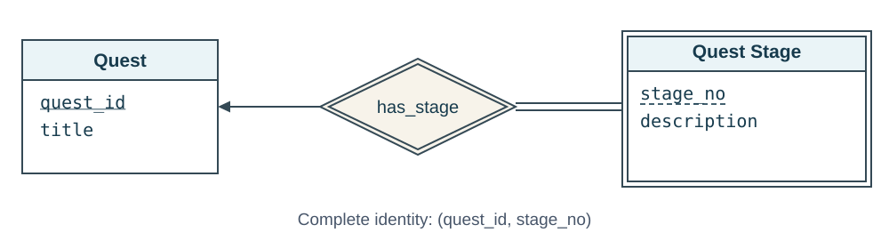
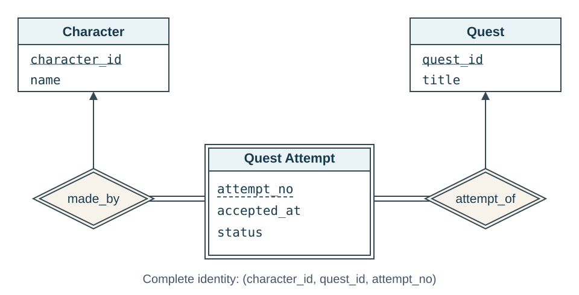
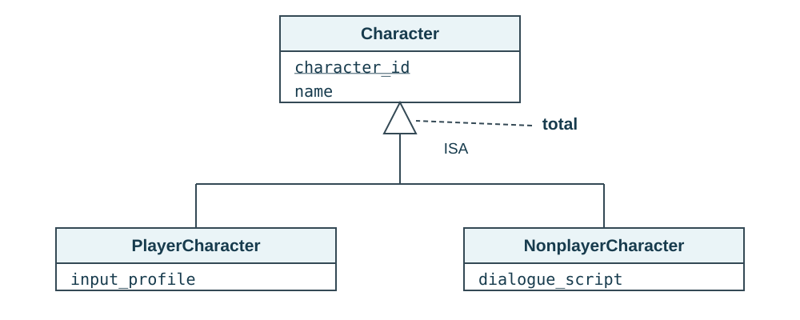
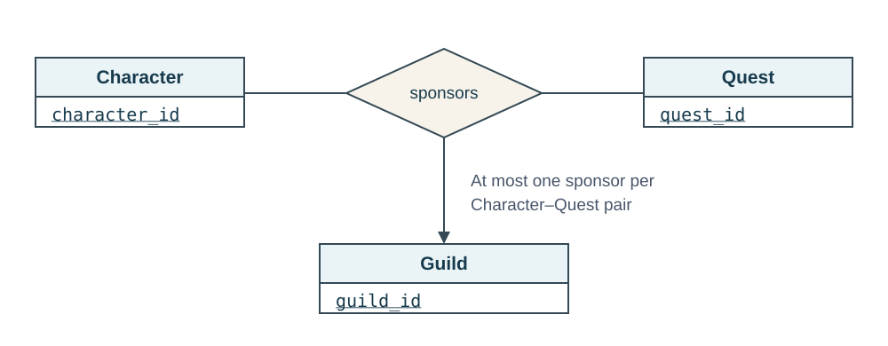
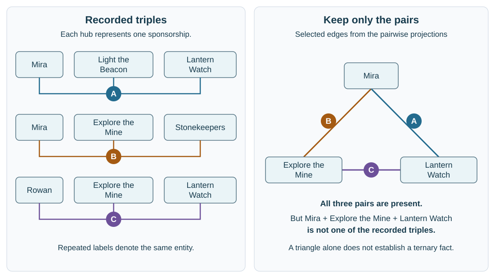
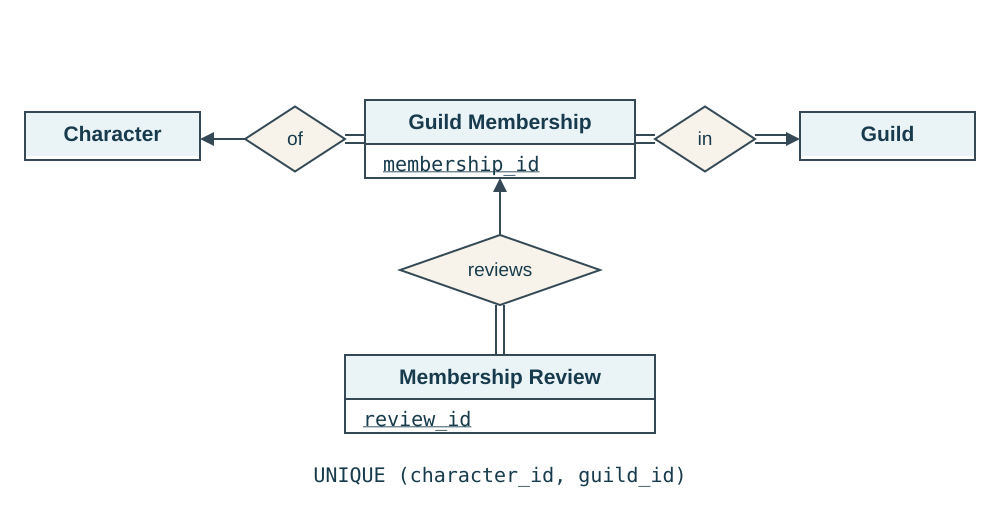
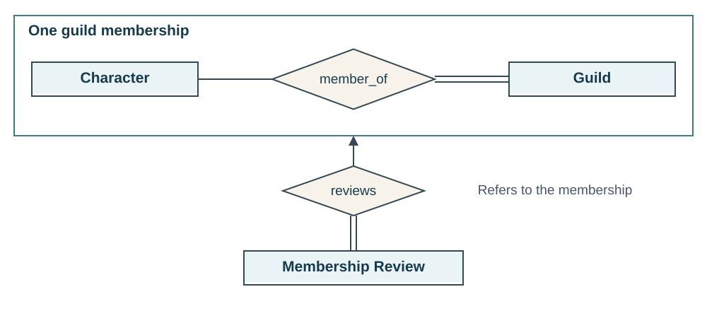

::: {.lesson-hero}
::: {.lesson-kicker}
WEEK 8 · ER DESIGN CHOICES
:::

# When does a simple relationship stop being enough?

- **Identity:** which quest's “stage 1”?
- **Subtypes:** what makes a player character different from an NPC?
- **Combinations:** which guild sponsors which character on which quest?
- **Associations:** which membership does a review concern?
:::

**Previous:** [Relationship keys and mapping ER models to relations](week-07-er-keys-and-cardinality.qmd).

**Focus:** choose the simplest model that preserves the required facts and constraints.

## 1. Weak entities need an owner for identification

- Suppose we want to represent quest stages. 
- Every **Quest Stage** belongs to exactly one **Quest**.
- `stage_no` is unique within a quest; other quests reuse the numbers.
- A quest may have no stages yet while it is being designed.

| quest_id | stage_no | description |
|---|---|---|
| 301 | 1 | Find the beacon tower. |
| 301 | 2 | Light the beacon. |
| 302 | 1 | Enter the Old Mine. |

**Complete identity:** `(quest_id, stage_no)`.

{fig-alt="Quest has underlined quest_id. Quest Stage has a double rectangle and dashed-underlined stage_no. The double-diamond has_stage identifying relationship points toward Quest. Double lines on the Quest Stage side require every stage to have an owner; the single line on the Quest side allows quests with no stages."}

| Concept | In this example | Notation |
|---|---|---|
| **Weak entity set** | Quest Stage | Double rectangle |
| **Identifying entity** | Quest, the owner | Ordinary entity rectangle |
| **Discriminator / partial key** | `stage_no`, unique within one quest | Dashed underline |
| **Identifying relationship** | `has_stage` | Double diamond |

- **Stage participation is total:** every stage needs a quest.
- **Quest participation is partial:** a quest may have no stages.
- **Weakness concerns identification:** a required foreign key alone is insufficient.

### Build the weak entity's primary key

::: {.callout-important appearance="simple"}
**Weak entity primary key = identifying owner's primary key + discriminator.**

For Quest Stage: `quest_id` + `stage_no` → **`(quest_id, stage_no)`**.

Include all key columns from every identifying owner, plus all discriminator columns.
:::

- Neither column is unique alone: quests have several stages, and stage numbers repeat across quests.
- The **pair** is unique: `(301, 1)` and `(302, 1)` are allowed; duplicate `(301, 1)` rows are not.
- The dashed underline marks the **partial key**; the identifying relationship supplies the owner identity.

### Map the weak entity to a relation

1. Create a relation containing the weak entity's attributes: `stage_no`, `description`.
2. Add the owner's primary-key column, `quest_id`, as a **foreign key** to `quest`.
3. Make **`(quest_id, stage_no)` together** the relation's primary key.

Assuming `quest(quest_id, ...)` already exists:

```sql
CREATE TABLE quest_stage (
    quest_id integer REFERENCES quest (quest_id),
    stage_no integer,
    description text,
    PRIMARY KEY (quest_id, stage_no)
);
```

- **Primary key:** the pair is unique and both columns are non-null.
- **Foreign key:** `quest_id` requires an existing quest and also contributes to the primary key.
- **No `has_stage` table:** the owner reference already records that association.
- **No stages yet:** the quest has no matching `quest_stage` rows.

**Use a weak entity when:** a distinguishable object has a local identifier meaningful only within its owner or owners.

### Revisit quest attempts: two identifying entities

**Quest Attempt** can use two owners and a local number instead of a standalone `attempt_id`.

{fig-alt="Quest Attempt is a double rectangle with dashed-underlined attempt_no and descriptive attributes accepted_at and status. Double-diamond identifying relationships made_by and attempt_of point toward Character and Quest. Double lines connect the attempt to both relationships. Both owner keys and attempt_no together identify the attempt; either owner may have zero or many attempts."}

| Concept | Quest Attempt |
|---|---|
| **Identifying entities** | Character and Quest, jointly supplying the context |
| **Discriminator / partial key** | `attempt_no`, unique within one character–quest pair |
| **Identifying relationships** | `made_by` and `attempt_of` |
| **Complete identity** | `(character_id, quest_id, attempt_no)` |

**Apply the same mapping rule:**

```text
quest_attempt(character_id, quest_id, attempt_no, accepted_at, status)
Primary key: (character_id, quest_id, attempt_no)
Foreign keys: character_id → game_character(character_id)
              quest_id → quest(quest_id)
```

- Both owner IDs are **primary-key components and foreign keys**; `attempt_no` is only a primary-key component.
- Every attempt needs both owners; either owner may have no attempts.
- A globally unique `attempt_id` gives independent identification: the earlier **strong-entity** option.

<details class="practice-solution">
<summary>University connection: Course and Section</summary>

**Course** describes a catalog entry; **Section** describes a particular offering. A section can be identified by:

```text
(course_id, section_no, semester, year)
```

- **Owner:** Course. **Discriminator:** `(section_no, semester, year)`.
- A section relates separately to its instructor and enrolled students.
- Two sections may share a course and instructor, so an instructor–course pair cannot identify a section.

</details>

## 2. Specialization represents an “is a” relationship

Suppose **Character** has two kinds with additional properties:

| Entity set | Properties shared or added |
|---|---|
| **Character** | `character_id`, `name` |
| **PlayerCharacter** | Adds `input_profile` |
| **NonplayerCharacter** | Adds `dialogue_script` |

- **Specialization:** start with the parent and identify subtypes.
- **Generalization:** start with similar entity sets and identify a shared parent.

Both produce an ISA hierarchy.

{fig-alt="PlayerCharacter and NonplayerCharacter connect through a shared hollow ISA arrow toward Character. Character has underlined character_id and name. The subclasses add input_profile and dialogue_script. The shared arrow indicates disjoint subtypes; total is explicitly labeled."}

### A subtype is the same entity in a narrower set

- A **PlayerCharacter is a Character**, with the same `character_id`.
- It inherits the parent's attributes and participation in relationships, such as location and guild membership.
- It may add attributes or relationships that apply only to that subtype.

This differs from a relationship such as **Character carries Item**: the character and item are different entities.

### State two independent constraints

| Question | Alternatives | Our character rule |
|---|---|---|
| Can one entity belong to multiple subtypes? | **Disjoint:** at most one. **Overlapping:** more than one allowed. | Disjoint: a character is not both player-controlled and an NPC. |
| Must every parent entity belong to a subtype? | **Total:** at least one. **Partial:** may belong to none. | Total: every character is one of these two kinds. |

**Book notation:**

- **Shared hollow arrow:** disjoint subtypes.
- **Separate hollow arrows:** overlapping subtypes.
- **`total` annotation:** every parent entity belongs to a subtype.

ISA arrows express inheritance, not relationship cardinality.

**Different example:** a **Person** can be both a **Student** and an **Employee**. That specialization is overlapping; it is partial if the database also includes people who are neither.

### When is specialization worth using?

**Use it for subtype-specific attributes, relationships, or constraints.** If the only difference is a label, an attribute such as `control_kind` may be enough.

### Map a subtype to a relation

Use **one relation for the parent and one for each subtype**:

1. Keep shared attributes, such as `name`, in the parent relation `game_character`.
2. Create each subtype relation with the **same primary key** and only its additional attributes.
3. Make that key a **foreign key** to the parent relation.

Assuming `game_character(character_id, name, ...)` already exists:

```sql
CREATE TABLE player_character (
    character_id integer PRIMARY KEY
        REFERENCES game_character (character_id),
    input_profile text
);

CREATE TABLE nonplayer_character (
    character_id integer PRIMARY KEY
        REFERENCES game_character (character_id),
    dialogue_script text
);
```

::: {.callout-note appearance="simple"}
### Same entity, same ID

Mira's `character_id = 101` appears in both relations:

- `game_character` stores her shared attributes, including `name`.
- `player_character` stores `input_profile`.

The subtype reuses her ID; it does not generate a new one.
:::

- **Primary key:** at most one player-character row per character.
- **Foreign key:** every player-character row must have a corresponding parent row.
- **Inherited attributes:** retrieve them by joining the subtype to its parent on `character_id`.

```sql
SELECT c.character_id, c.name, p.input_profile
FROM game_character AS c
JOIN player_character AS p USING (character_id);
```

**Still needs enforcement:**

- **Total:** every parent ID must occur in a subtype.
- **Disjoint:** no ID may occur in both subtype relations.

## 3. Higher-order relationships preserve facts about combinations

A **ternary relationship** connects three participants in one fact. More generally, an **n-ary relationship** has n participating roles.

**Game rule:** a guild can sponsor a character on a particular quest. Each character–quest pair has at most one sponsoring guild.

{fig-alt="Character, Quest, and Guild connect to one sponsors diamond. An arrow toward Guild means a given Character–Quest pair has at most one sponsoring Guild. Character and Quest connections have no arrows."}

**Read the arrow by holding the other two participants fixed.** A guild can sponsor many characters and many quests.

::: {.callout-note appearance="simple"}
### At most one arrow for a higher-order relationship

- The book permits **at most one arrow out of a nonbinary relationship**: multiple arrows have competing interpretations.
- State additional uniqueness rules explicitly. Functional dependencies, covered next, express them precisely.
:::

<details class="practice-solution">
<summary>Why would two arrows be ambiguous?</summary>

Suppose `sponsors` had arrows toward both Quest and Guild. Two interpretations are possible:

- **Character determines the whole pair:** each character has at most one quest–guild combination.
- **Each arrow holds the other participants fixed:** each character–quest pair has at most one guild, and each character–guild pair has at most one quest.

The second permits Mira to have two sponsorships involving different quests and different guilds; the first does not. These rules imply different keys, so we avoid drawing two arrows.

</details>

| Character | Quest | Sponsoring guild |
|---|---|---|
| Mira | Light the Beacon | Lantern Watch |
| Mira | Explore the Mine | Stonekeepers |
| Rowan | Explore the Mine | Lantern Watch |

- **Issuer:** the guild in the existing `offers` relationship.
- **Sponsor:** the guild supporting a particular character's participation; it may differ from the issuer.

If these always had to be the same guild, recording the sponsor again would be redundant.

### Why three pairwise relationships can lose information

{fig-alt="Three recorded sponsorships appear as hubs A, B, and C joining their three participants. The pairwise graph forms a triangle between Mira, Explore the Mine, and Lantern Watch, but its edges come from three different hubs: Mira–Lantern Watch from A, Mira–Explore the Mine from B, and Explore the Mine–Lantern Watch from C. No recorded hub joins that triple."}

- **Left:** each hub keeps one complete sponsorship.
- **Right:** all three pairs exist, but their edges come from different sponsorships.
- **Lost information:** which three participants belonged to the *same* fact.

The triangle suggests **Mira–Explore the Mine–Lantern Watch**, which was never recorded. Hubs illustrate individual facts; they are not new entity types or IDs.

::: {.callout-important appearance="simple"}
### A connection among three entities is one fact

Use a ternary relationship when the meaning depends on the whole combination. Three binary relationships among the original entities are not automatically equivalent.
:::

### Map the relationship to a relation

1. Create a separate `sponsorship` relation with the keys of **all three participants**, each referencing its entity relation.
2. Add any descriptive attributes of the relationship, if needed.
3. Choose the primary key from the cardinality rule: **`(character_id, quest_id)`**, because that pair determines the sponsoring guild.

Assuming the three entity relations already exist:

```sql
CREATE TABLE sponsorship (
    character_id integer REFERENCES game_character (character_id),
    quest_id integer REFERENCES quest (quest_id),
    guild_id integer NOT NULL REFERENCES guild (guild_id),
    PRIMARY KEY (character_id, quest_id)
);
```

**All three participant keys are columns; only two form the primary key.**

- **Primary key:** one sponsor per character–quest pair; both columns are non-null.
- **`guild_id`:** required in each row, but may repeat across rows.
- **No sponsor:** no sponsorship row.
- **Do not use all three as the key:** that would permit different guilds for the same pair.

**What if several guilds could jointly sponsor the same character on the same quest?** Remove the arrow and, with no further uniqueness rule, use `PRIMARY KEY (character_id, quest_id, guild_id)`. Keep all three foreign keys.

**Prefer binary relationships when the facts are independent.** A character's current location and guild memberships are separate facts; a three-way relationship would unnecessarily couple them.

## 4. Aggregation: make an association something we can refer to

Suppose guilds review members for promotion. A review concerns **Mira's membership in the Lantern Watch**:

- Character alone does not identify which guild.
- Guild alone does not identify which member.
- Each review concerns **one membership**; a membership may have **zero or many reviews**.

### Start with a familiar design: an explicit entity

Introduce **Guild Membership**, an *associative entity* representing the character–guild association:

- Give it `membership_id` for convenient reference.
- Require exactly one character and one guild.
- Link each review to its membership.

{fig-alt="Guild Membership has underlined membership_id and total participation in many-to-one relationships toward Character and Guild. Guild also participates totally, preserving the rule that every guild has a member. Membership Review has underlined review_id and total participation in a many-to-one reviews relationship toward Guild Membership. Each character–guild pair must be unique."}

**Preserve the constraints:**

- `UNIQUE (character_id, guild_id)` prevents duplicate memberships.
- Both participant IDs are non-null foreign keys.
- Every guild still needs at least one member; foreign keys alone do not enforce this.

The new ID is optional: the character–guild pair can identify the membership instead.

### Connect this design to textbook aggregation

**Aggregation** treats a relationship and its participants as an object that another relationship can reference. This is separate from SQL aggregation (`SUM`, `COUNT`).

{fig-alt="An aggregation boundary encloses Character, member_of, and Guild. member_of is many-to-many, with total participation from Guild and partial participation from Character. The aggregate connects through reviews to Membership Review. An arrow toward the aggregate and double lines beside Membership Review require each review to concern exactly one membership; a membership may have several reviews or none."}

| Approach | How we refer to the association |
|---|---|
| **Textbook aggregation** | Enclose `member_of` and its participants; treat each membership as an abstract entity identified by the character–guild pair. |
| **Explicit associative entity** | Draw Guild Membership as an entity connected to Character and Guild. Choose the pair as its key or give it its own ID. |

Both preserve the same requirement and constraints. The book also describes replacing a relationship with an entity and binary relationships.

::: {.callout-note appearance="simple"}
### Adding an ID is not the definition of aggregation

- **Aggregation:** make an association something other facts can concern.
- **New ID:** an optional identification choice; adding a column alone does not change the conceptual model.
:::

### Map the aggregate to relations

Using the **character–guild pair** as the membership key, map the textbook diagram in three steps:

1. Keep `member_of` as a relation with primary key `(character_id, guild_id)`.
2. Create `membership_review` with its own key and descriptive attributes.
3. Put the **whole membership key** in each review as a composite foreign key to `member_of`.

```sql
CREATE TABLE member_of (
    character_id integer REFERENCES game_character (character_id),
    guild_id integer REFERENCES guild (guild_id),
    PRIMARY KEY (character_id, guild_id)
);

CREATE TABLE membership_review (
    review_id integer GENERATED ALWAYS AS IDENTITY PRIMARY KEY,
    character_id integer NOT NULL,
    guild_id integer NOT NULL,
    reviewed_at timestamptz NOT NULL,
    outcome text,
    FOREIGN KEY (character_id, guild_id)
        REFERENCES member_of (character_id, guild_id)
);
```

**What the mapping preserves:**

- **Existing membership:** the composite foreign key requires this character–guild pair in `member_of`. Separate references to Character and Guild would not.
- **Several reviews:** the membership pair may repeat; `review_id` distinguishes reviews.
- **No reviews yet:** the membership row still exists.
- **No extra `reviews` table:** the non-null reference records each review's single membership. The aggregation boundary needs no additional table.

<details class="practice-solution">
<summary>Alternative mapping with membership_id</summary>

```text
guild_membership(membership_id, character_id, guild_id)
Primary key: membership_id
Unique: (character_id, guild_id)
Both participant IDs: non-null foreign keys

membership_review(review_id, membership_id, reviewed_at, outcome)
Primary key: review_id
membership_id: non-null foreign key to guild_membership
```

Replace the composite reference with `membership_id NOT NULL REFERENCES guild_membership(membership_id)`. Keep the pair's uniqueness constraint. Use this design or the composite-key design above, not both.

</details>

**When to use it:**

- **Relationship attributes suffice:** one `joined_at` value can stay on `member_of`.
- **Other facts reference the association:** separate reviews motivate treating membership as an object.

**Check:** We now want to keep each separate period of guild membership. Mira joins the Lantern Watch, leaves, and later rejoins. How should the `membership_id` design change to store both periods and keep each review attached to the correct period?

<details class="practice-solution">
<summary>Possible answer</summary>

Model **each membership period as an entity**:

```text
guild_membership(membership_id, character_id, guild_id, joined_at, left_at)
Primary key: membership_id
Foreign keys: character_id → game_character; guild_id → guild
```

- **One ID per period:** Mira's two periods have different `membership_id` values but the same character and guild IDs.
- **Remove `UNIQUE (character_id, guild_id)`:** the pair must be allowed to repeat. Keep both foreign keys non-null.
- **Record the period:** `joined_at` is required; `left_at` may be null for a current membership.
- **Keep reviews tied to `membership_id`:** each review refers to the relevant period.

The earlier associative entity already had its own ID, but its pair-uniqueness rule still allowed only one membership per character and guild. The change is to identify **membership periods** and permit repeated pairs. Any rule against overlapping periods needs separate enforcement.

</details>


</details>

## Reference and reading

Based on Silberschatz, Korth, and Sudarshan, *Database System Concepts*, 7th edition, Chapter 6, “Database Design Using the E-R Model,” including extended ER features and design choices.

[Course resources](../resources.qmd) · [Authors' Chapter 6 slides](https://www.db-book.com/slides-dir/PDF-dir/ch6.pdf)

The game-world diagrams and data examples here are original illustrations of these concepts.
