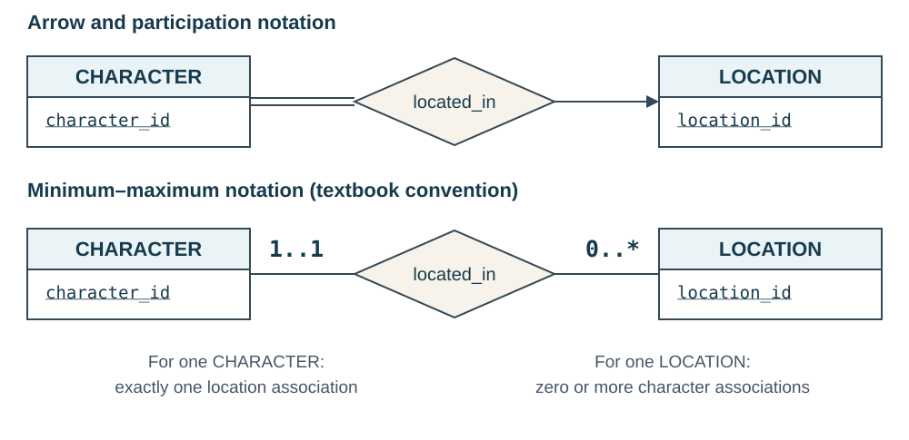

::: {.lesson-hero}
::: {.lesson-kicker}
WEEK 8 · ER DESIGN CHOICES
:::

# When does a simple relationship stop being enough?

“Stage 1” needs a quest. A player character has properties an NPC does not. A guild sponsors a character on a quest. A review concerns one of that character's guild memberships. Each requirement asks us to represent a different kind of fact.
:::

**Previous:** [Relationship keys and mapping ER models to relations](week-07-er-keys-and-cardinality.qmd).

**Focus:** choose the simplest model that preserves the required facts and constraints. We extend the game world with quest stages, character subtypes, guild sponsorship, and membership reviews.

## 1. Weak entities need an owner for identification

**Question:** Which quest's “stage 1” do we mean?

- Every **Quest Stage** belongs to exactly one **Quest**.
- `stage_no` is unique within a quest; other quests reuse the numbers.
- A quest may have no stages yet while it is being designed.

| quest_id | stage_no | description |
|---|---|---|
| 301 | 1 | Find the beacon tower. |
| 301 | 2 | Light the beacon. |
| 302 | 1 | Enter the Old Mine. |

**Complete identity:** `(quest_id, stage_no)`. The stage number identifies a stage only when we know its quest.

{fig-alt="Quest has underlined quest_id. Quest Stage has a double rectangle and dashed-underlined stage_no. The double-diamond has_stage identifying relationship points toward Quest. Double lines on the Quest Stage side require every stage to have an owner; the single line on the Quest side allows quests with no stages."}

| Concept | In this example | Notation |
|---|---|---|
| **Weak entity set** | Quest Stage | Double rectangle |
| **Identifying entity** | Quest, the owner | Ordinary entity rectangle |
| **Discriminator / partial key** | `stage_no`, unique within one quest | Dashed underline |
| **Identifying relationship** | `has_stage` | Double diamond |

- **Every weak entity needs its owner:** total participation in the identifying relationship.
- **The owner need not have children:** our model allows a quest with no stages yet.
- **A required foreign key alone does not make an entity weak.** The owner contributes to its identification.

### Map the identity to a relation

```text
quest_stage(quest_id, stage_no, description)
Primary key: (quest_id, stage_no)
Foreign key: quest_id → quest
```

The identifying relationship supplies the owner key. Include it in `quest_stage`; a separate `has_stage` table is unnecessary.

**Use a weak entity when:** a distinguishable object has a local identifier meaningful only within its owner or owners.

### Revisit quest attempts: two identifying entities

The earlier **Quest Attempt** example can also be modeled as a weak entity, using `(character_id, quest_id, attempt_no)` instead of a standalone `attempt_id`.

{fig-alt="Quest Attempt is a double rectangle with dashed-underlined attempt_no and descriptive attributes accepted_at and status. Double-diamond identifying relationships made_by and attempt_of point toward Character and Quest. Double lines connect the attempt to both relationships. Both owner keys and attempt_no together identify the attempt; either owner may have zero or many attempts."}

| Concept | Quest Attempt |
|---|---|
| **Identifying entities** | Character and Quest, jointly supplying the context |
| **Discriminator / partial key** | `attempt_no`, unique within one character–quest pair |
| **Identifying relationships** | `made_by` and `attempt_of` |
| **Complete identity** | `(character_id, quest_id, attempt_no)` |

Each attempt requires both owners; either owner may have no attempts. With a globally unique `attempt_id`, the attempt is independently identified—the strong-entity option from the previous lecture.

<details class="practice-solution">
<summary>University connection: Course and Section</summary>

**Course** describes a catalog entry; **Section** describes a particular offering. A section can be identified by:

```text
(course_id, section_no, semester, year)
```

The course supplies the owner identity; `(section_no, semester, year)` is the discriminator. A section relates separately to its instructor and enrolled students.

Two sections can have the same course and instructor. Modeling Section solely as an instructor–course relationship would lose that distinction. This is the textbook's central weak-entity example.

</details>

## 2. Specialization represents an “is a” relationship

Suppose **Character** has two kinds with additional properties:

| Entity set | Properties shared or added |
|---|---|
| **Character** | `character_id`, `name` |
| **PlayerCharacter** | Adds `input_profile` |
| **NonplayerCharacter** | Adds `dialogue_script` |

**Specialization** starts with a general entity set and identifies useful subsets. **Generalization** starts with similar entity sets and brings their shared properties into a common parent. Both produce the same kind of hierarchy.

{fig-alt="PlayerCharacter and NonplayerCharacter connect through a shared hollow ISA arrow toward Character. Character has underlined character_id and name. The subclasses add input_profile and dialogue_script. The shared arrow indicates disjoint subtypes; total is explicitly labeled."}

### A subtype is the same entity in a narrower set

- A **PlayerCharacter is a Character**, with the same `character_id`.
- It inherits the parent's attributes and participation in relationships, such as location and guild membership.
- It may add attributes or relationships that apply only to that subtype.

This differs from a relationship such as **Character carries Item**: the character and item are different entities.

### State two independent constraints

| Question | Alternatives | Our character rule |
|---|---|---|
| Can one entity belong to multiple subtypes? | **Disjoint:** at most one. **Overlapping:** more than one allowed. | Disjoint: a character is not both player-controlled and an NPC. |
| Must every parent entity belong to a subtype? | **Total:** at least one. **Partial:** may belong to none. | Total: every character is one of these two kinds. |

The book uses a **shared hollow arrow** for disjoint subtypes and **separate hollow arrows** for overlapping ones. A `total` annotation states completeness. These are ISA arrows, not relationship-cardinality arrows.

**Different example:** a **Person** can be both a **Student** and an **Employee**. That specialization is overlapping; it is partial if the database also includes people who are neither.

### When is specialization worth using?

**Use it for subtype-specific attributes, relationships, or constraints.** If the only difference is a label, an attribute such as `control_kind` may be enough.

A standard relational mapping uses:

```text
character(character_id, name)
player_character(character_id, input_profile)
nonplayer_character(character_id, dialogue_script)
```

Each subtype's `character_id` is both its **primary key** and a **foreign key** to `character`. Those keys do not, by themselves, enforce total or disjoint membership across the subtype tables.

**Check:** Does putting different entities in different tables automatically establish an ISA relationship?

<details class="practice-solution">
<summary>Possible answer</summary>

No. An ISA relationship says each subtype member is the same entity as a member of the parent set, inheriting its identity and properties. Separate tables alone do not express that meaning.

</details>

## 3. Higher-order relationships preserve facts about combinations

A **ternary relationship** connects three participants in one fact. More generally, an **n-ary relationship** has n participating roles.

**Game rule:** a guild can sponsor a character on a particular quest. Each character–quest pair has at most one sponsoring guild.

{fig-alt="Character, Quest, and Guild connect to one sponsors diamond. An arrow toward Guild means a given Character–Quest pair has at most one sponsoring Guild. Character and Quest connections have no arrows."}

**Read the arrow by holding the other two participants fixed.** A guild can sponsor many characters and many quests.

| Character | Quest | Sponsoring guild |
|---|---|---|
| Mira | Light the Beacon | Lantern Watch |
| Mira | Explore the Mine | Stonekeepers |
| Rowan | Explore the Mine | Lantern Watch |

**Sponsoring is separate from issuing.** Our existing `offers` relationship identifies the guild that issues a quest. Another guild may sponsor a character's participation. If the sponsor always had to be the issuer, recording it again would be redundant.

### Why three pairwise relationships can lose information

From these rows, we can learn that:

- Mira has sponsorship from the Lantern Watch.
- Mira undertakes Explore the Mine.
- The Lantern Watch sponsors participation in Explore the Mine.

But **the Lantern Watch does not sponsor Mira on Explore the Mine** in these records. Even storing all three kinds of pairs loses which triples actually occurred.

::: {.callout-important appearance="simple"}
### A connection among three entities is one fact

Use a ternary relationship when the meaning depends on the whole combination. Three binary relationships among the original entities are not automatically equivalent.
:::

### Keys follow the stated rule

For our rule, `(character_id, quest_id)` identifies a sponsorship; `guild_id` is the uniquely determined partner. A character–quest pair with no sponsor has no sponsorship row.

**What if several guilds could jointly sponsor the same character on the same quest?** Remove the arrow. With no further uniqueness rule, all three participant keys identify the association.

**Prefer binary relationships when the facts are independent.** A character's current location and guild memberships are separate facts; a three-way relationship would unnecessarily couple them.

## 4. Aggregation: make an association something we can refer to

Return to **Character — member_of — Guild**. Characters may join several guilds. Suppose each guild periodically reviews its members for promotion.

Each **Membership Review** concerns one particular membership: Mira's membership in the Lantern Watch. A membership can exist without reviews and accumulate several reviews.

Relating a review to only the character loses the guild context; relating it to only the guild loses the member. The review concerns **their association**.

### Start with a familiar design: an explicit entity

Represent the association as a **Guild Membership** entity—an *associative entity*, whose meaning is an association among other entities.

- Give it `membership_id` for convenient reference.
- Require exactly one character and one guild per membership.
- Relate each **Membership Review** to exactly one membership.
- Keep memberships even when they have no reviews.

{fig-alt="Guild Membership has underlined membership_id and total participation in many-to-one relationships toward Character and Guild. Guild also participates totally, preserving the rule that every guild has a member. Membership Review has underlined review_id and total participation in a many-to-one reviews relationship toward Guild Membership. Each character–guild pair must be unique."}

### Preserve the original constraints

```text
guild_membership(membership_id, character_id, guild_id)
Primary key: membership_id
Unique: (character_id, guild_id)
Both participant IDs: non-null foreign keys

membership_review(review_id, membership_id, reviewed_at, outcome)
Primary key: review_id
membership_id: non-null foreign key to guild_membership
```

The `UNIQUE` constraint preserves **one membership per character–guild pair**. A new ID alone would allow duplicate memberships. Our existing rule that every guild has at least one member still needs enforcement beyond these keys and foreign keys.

**The generated ID is optional.** We could instead identify the membership by `(character_id, guild_id)` and use a composite reference from Membership Review.

### Connect this design to textbook aggregation

**Aggregation** treats a relationship and its participating entities as a higher-level object that can participate in another relationship. It is unrelated to SQL functions such as `SUM` and `COUNT`.

{fig-alt="An aggregation boundary encloses Character, member_of, and Guild. member_of is many-to-many, with total participation from Guild and partial participation from Character. The aggregate connects through reviews to Membership Review. An arrow toward the aggregate and double lines beside Membership Review require each review to concern exactly one membership; a membership may have several reviews or none."}

| Approach | How we refer to the association |
|---|---|
| **Textbook aggregation** | Enclose `member_of` and its participants; treat each membership as an abstract entity identified by the character–guild pair. |
| **Explicit associative entity** | Draw Guild Membership as an entity connected to Character and Guild. Choose the pair as its key or give it its own ID. |

Both can express this requirement when the constraints are preserved. The book and slides also describe replacing a relationship with an entity and binary relationships, including the option of adding an identifying attribute.

::: {.callout-note appearance="simple"}
### Adding an ID is not the definition of aggregation

The modeling step is to treat the association as an object that other facts can concern. A new ID is an identification choice. Adding an ID column to a relationship table alone does not change the conceptual model.
:::

**Use this approach when:** another entity or relationship must refer to a particular association, or the association has become an event or record with its own history.

**Keep a relationship when:** descriptive attributes are sufficient. A single `joined_at` value can be a membership relationship attribute; several separately recorded reviews motivate referring to the membership itself.

**Check:** If Mira leaves a guild and later rejoins, can this model keep two separate membership periods for her in that guild?

<details class="practice-solution">
<summary>Possible answer</summary>

No. `UNIQUE (character_id, guild_id)` permits only one membership per pair. To keep separate periods, model each period as a distinct occurrence, define its identity and dates, and attach reviews to the appropriate period. A generated ID alone does not define those rules.

</details>

## 5. Choose the construct from the requirement

| Requirement | Consider | Ask before choosing |
|---|---|---|
| A local number identifies an object only within its owner or owners. | **Weak entity** | Which owner keys complete the identity? |
| Some members have additional properties or relationships. | **Specialization** | Are they subtypes of the same entity? Disjoint or overlapping? Total or partial? |
| A fact depends on three or more participants together. | **Higher-order relationship** | Would keeping only pairs lose the actual combinations? |
| Another fact concerns a particular association. | **Aggregation / associative entity** | What identifies the association, and which constraints must survive? |
| A simple property or binary association captures the requirement. | **Existing basic ER constructs** | Does an extension add useful meaning? |

**Before mapping the model:** explain each entity's identity, each relationship's meaning, and every participation or uniqueness rule. Try a valid edge case—two local “1” values, a person in two subtypes, or a membership with no reviews.

**Next:** use functional dependencies and normalization to examine redundancy and anomalies in the resulting relations.

<details class="practice-solution">
<summary>Optional notation reference: minimum–maximum ranges</summary>

A range `a..b` beside an entity counts the associations involving **one entity of that set**.

| Range | Meaning |
|---|---|
| `0..1` | Optional, at most one |
| `1..1` | Exactly one |
| `0..*` | Zero or more |
| `1..*` | At least one |
| `2..8` | Between two and eight, inclusive |

{fig-alt="In arrow notation, Character has total participation and located_in points to Location. With ranges, 1..1 is beside Character and 0..* is beside Location."}

The range beside **Character** counts its associations; the arrow toward **Location** identifies its single partner. Ranges replace arrow and single/double-line markings. Follow the notation's legend when switching conventions.

</details>

## Reference and reading

Based on Silberschatz, Korth, and Sudarshan, *Database System Concepts*, 7th edition, Chapter 6, “Database Design Using the E-R Model,” including extended ER features and design choices.

[Course resources](../resources.qmd) · [Authors' Chapter 6 slides](https://www.db-book.com/slides-dir/PDF-dir/ch6.pdf)

The game-world diagrams and data examples here are original illustrations of these concepts.
