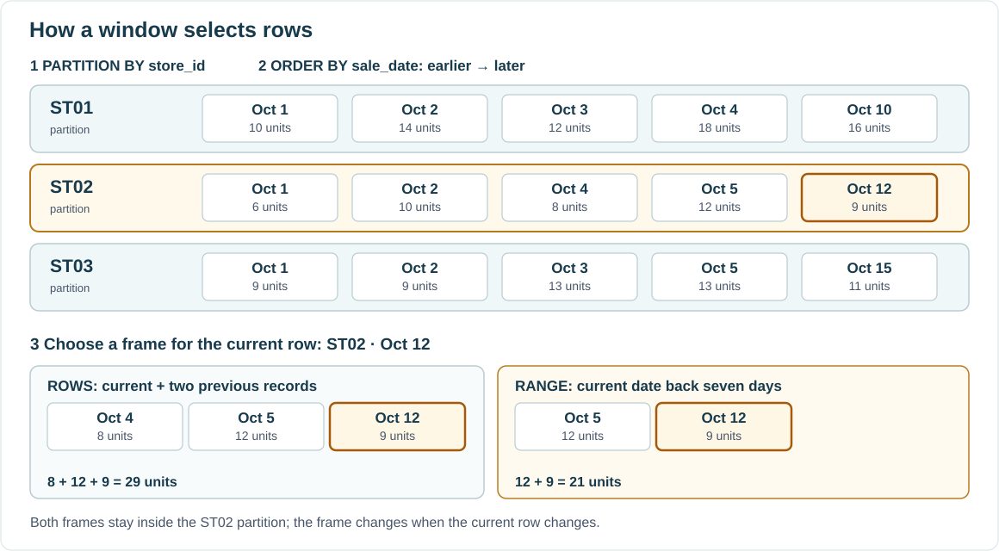

::: {.lesson-hero}
::: {.lesson-kicker}
WEEK 11 · WINDOW FUNCTIONS
:::

# How can each row show what happened before it?

`GROUP BY` combines rows into summaries. A **window function** calculates across related rows while keeping each original row in the result.
:::

**Previous:** [Lab 3 — Explore bakery sales with SQL and Polars](../activities/week-10-polars-query-lab.qmd). We will use a small, synthetic daily-sales table so the order of the rows and the calculations are easy to see.

## 1. Start with one row per store and date

`daily_sales` records the number of units sold at each store on each recorded date. The pair `(store_id, sale_date)` is unique. Some dates have no row; for example, ST02 has **no row for October 3**.

| store_id | sale_date | units |
|---|---|---:|
| ST01 | Oct 1 | 10 |
| ST01 | Oct 2 | 14 |
| ST01 | Oct 3 | 12 |
| ST01 | Oct 4 | 18 |
| ST01 | Oct 10 | 16 |
| ST02 | Oct 1 | 6 |
| ST02 | Oct 2 | 10 |
| ST02 | Oct 4 | 8 |
| ST02 | Oct 5 | 12 |
| ST02 | Oct 12 | 9 |
| ST03 | Oct 1 | 9 |
| ST03 | Oct 2 | 9 |
| ST03 | Oct 3 | 13 |
| ST03 | Oct 5 | 13 |
| ST03 | Oct 15 | 11 |

<details class="practice-example">
<summary>Load the example in PostgreSQL</summary>

Run this once in a PostgreSQL session. The temporary table lasts only for that session.

```sql
CREATE TEMP TABLE daily_sales (
    store_id text NOT NULL,
    sale_date date NOT NULL,
    units integer NOT NULL,
    PRIMARY KEY (store_id, sale_date)
);

INSERT INTO daily_sales (store_id, sale_date, units) VALUES
    ('ST01', DATE '2026-10-01', 10),
    ('ST01', DATE '2026-10-02', 14),
    ('ST01', DATE '2026-10-03', 12),
    ('ST01', DATE '2026-10-04', 18),
    ('ST01', DATE '2026-10-10', 16),
    ('ST02', DATE '2026-10-01',  6),
    ('ST02', DATE '2026-10-02', 10),
    ('ST02', DATE '2026-10-04',  8),
    ('ST02', DATE '2026-10-05', 12),
    ('ST02', DATE '2026-10-12',  9),
    ('ST03', DATE '2026-10-01',  9),
    ('ST03', DATE '2026-10-02',  9),
    ('ST03', DATE '2026-10-03', 13),
    ('ST03', DATE '2026-10-05', 13),
    ('ST03', DATE '2026-10-15', 11);
```

</details>

### Grouped result or row-level result?

```sql
SELECT store_id, SUM(units) AS store_total
FROM daily_sales
GROUP BY store_id
ORDER BY store_id;
```

This returns **three rows**: ST01 has 70 units, ST02 has 45, and ST03 has 55. To show each day's units *beside* its store total, use `OVER`:

```sql
SELECT store_id, sale_date, units,
       SUM(units) OVER (PARTITION BY store_id) AS store_total
FROM daily_sales
ORDER BY store_id, sale_date;
```

::: {.callout-note appearance="simple"}
**`GROUP BY` collapses rows; `OVER` keeps them.** The second query returns all **15 store-date rows**, each with its store total. `PARTITION BY store_id` selects the related rows; without a window `ORDER BY`, the sum sees the whole store partition.
:::

### Partition versus frame

*Database System Concepts* uses within-department ranking to illustrate **partitions**, then moving averages to illustrate **frames**. The same row belongs to just one partition, but frames for nearby rows can overlap.

- **Partition:** `PARTITION BY store_id` puts all five ST01 rows together, separately from ST02 and ST03.
- **Frame:** with `ROWS BETWEEN 2 PRECEDING AND CURRENT ROW`, ST01's October 3 calculation sees October 1–3; its October 4 calculation sees October 2–4. The frame changes with the current row and stays inside its partition.

{fig-alt="Three store partitions contain rows ordered by date. For the current ST02 row on October 12, a three-record ROWS frame contains October 4, 5, and 12; a seven-day RANGE frame contains October 5 and 12. Both frames remain inside ST02."}

For the highlighted ST02 row, the frame is a subset of **ST02's** ordered rows. Neither frame can include sales from ST01 or ST03.

The general shape is:

```sql
function_name(arguments) OVER (
    PARTITION BY group_expression
    ORDER BY sort_expression
    ROWS BETWEEN frame_start AND frame_end
)
```

- `OVER` is required; partition, order, and frame clauses are optional.
- `ROWS` counts records. `RANGE` can measure elapsed calendar time; PostgreSQL also supports `GROUPS`.
- `LAG` and `ROW_NUMBER` use the partition and order but do not depend on the frame.

## 2. Add order and a frame

For a **running total**, include the current row and every earlier row for that store. For a **three-record rolling average**, include the current row and up to two earlier rows:

```sql
SELECT store_id, sale_date, units,
       SUM(units) OVER (
           PARTITION BY store_id ORDER BY sale_date
           ROWS BETWEEN UNBOUNDED PRECEDING AND CURRENT ROW
       ) AS running_units,
       ROUND(AVG(units) OVER (
           PARTITION BY store_id ORDER BY sale_date
           ROWS BETWEEN 2 PRECEDING AND CURRENT ROW
       ), 1) AS last_three_avg
FROM daily_sales
ORDER BY store_id, sale_date;
```

| store_id | sale_date | units | running_units | last_three_avg |
|---|---|---:|---:|---:|
| ST01 | Oct 1 | 10 | 10 | 10.0 |
| ST01 | Oct 2 | 14 | 24 | 12.0 |
| ST01 | Oct 3 | 12 | 36 | 12.0 |
| ST01 | Oct 4 | 18 | 54 | 14.7 |
| ST01 | Oct 10 | 16 | 70 | 15.3 |
| ST02 | Oct 1 | 6 | 6 | 6.0 |
| ST02 | Oct 2 | 10 | 16 | 8.0 |
| ST02 | Oct 4 | 8 | 24 | 8.0 |
| ST02 | Oct 5 | 12 | 36 | 10.0 |
| ST02 | Oct 12 | 9 | 45 | 9.7 |
| ST03 | Oct 1 | 9 | 9 | 9.0 |
| ST03 | Oct 2 | 9 | 18 | 9.0 |
| ST03 | Oct 3 | 13 | 31 | 10.3 |
| ST03 | Oct 5 | 13 | 44 | 11.7 |
| ST03 | Oct 15 | 11 | 55 | 12.3 |

- **Partition:** the calculation restarts for each `store_id`.
- **Order:** `sale_date` puts each store's records in sequence. The primary key guarantees one row per store and date, so there are no ties to break.
- **Frame:** `ROWS BETWEEN ...` selects the rows the aggregate sees. Early rows use the observations available so far.
- **Display:** the final `ORDER BY` sorts the output; the `ORDER BY` inside `OVER` controls the calculation.

To average **all observations so far** instead, change the average's frame start from `2 PRECEDING` to `UNBOUNDED PRECEDING`.

::: {.callout-note appearance="simple"}
**Three records are not always three calendar days.** ST02's October 4 average uses October 1, 2, and 4 because October 3 has no row. `ROWS` counts observations. We specify the frame explicitly; PostgreSQL's default frame with a window `ORDER BY` can also include rows tied on the ordering value.
:::

### Look back seven calendar days

For a rolling total over **calendar time**, use a `RANGE` frame with an interval:

```sql
SELECT store_id, sale_date, units,
       SUM(units) OVER (
           PARTITION BY store_id ORDER BY sale_date
           RANGE BETWEEN INTERVAL '7 days' PRECEDING AND CURRENT ROW
       ) AS units_last_7_days
FROM daily_sales
ORDER BY store_id, sale_date;
```

- **Duration:** `INTERVAL '7 days'` is PostgreSQL's readable notation; `INTERVAL '1 week'` means the same thing.
- **Boundary:** the frame starts at `sale_date - INTERVAL '7 days'` and includes both that date and the current date.
- **ST02 on October 12:** `RANGE` includes October 5 and 12, totaling **21** units. A three-record `ROWS` frame includes October 4, 5, and 12, totaling **29** units.

::: {.callout-note appearance="simple"}
**An offset is not elapsed time.** `LAG(units, 7)` means seven *recorded rows* back, not seven calendar days. Choose `ROWS` or a time-based `RANGE` according to the question.
:::

<details class="practice-example">
<summary>Practice 1: which rows are in the frame?</summary>

For **ST03 on October 15**, which dates enter (a) a three-record `ROWS` frame and (b) the seven-day `RANGE` frame above? Calculate the three-record average and the seven-day total.

<details class="practice-solution">
<summary>Possible answer</summary>

- **Three-record `ROWS`:** October 3, 5, and 15. The average is `(13 + 13 + 11) / 3 = 12.3` units when rounded to one decimal place.
- **Seven-day `RANGE`:** only October 15 falls between October 8 and 15, so the total is **11** units.

Both frames remain inside the ST03 partition.

</details>
</details>

## 3. Compare with the previous recorded row

`LAG(units)` returns the prior value **within the same store**, in date order. The CTE names that value so we can subtract it in the outer query:

```sql
WITH previous_sale AS (
    SELECT store_id, sale_date, units,
           LAG(sale_date) OVER (
               PARTITION BY store_id ORDER BY sale_date
           ) AS previous_date,
           LAG(units) OVER (
               PARTITION BY store_id ORDER BY sale_date
           ) AS previous_units
    FROM daily_sales
)
SELECT store_id, sale_date, units, previous_date, previous_units,
       units - previous_units AS change_in_units
FROM previous_sale
ORDER BY store_id, sale_date;
```

- ST01's October 3 change is `12 - 14 = -2` units.
- ST02's October 4 change is `8 - 10 = -2`; its previous **recorded** date is October 2.
- The first row for each store has no previous row, so `previous_units` and the difference are `NULL`.

`LEAD` looks forward instead; `LAG(units, 2)` looks two recorded rows back. Neither implies a fixed amount of clock time when dates are missing.

## 4. Another use: choose one row per group

To find each store's highest-sales date, number its rows from highest to lowest units. A date breaks any tie:

```sql
WITH ranked_days AS (
    SELECT store_id, sale_date, units,
           ROW_NUMBER() OVER (
               PARTITION BY store_id
               ORDER BY units DESC, sale_date
           ) AS position
    FROM daily_sales
)
SELECT store_id, sale_date, units
FROM ranked_days
WHERE position = 1
ORDER BY store_id;
```

The result is **ST01 on October 4 (18 units)**, **ST02 on October 5 (12 units)**, and **ST03 on October 3 (13 units)**. ST03 also sold 13 units on October 5; the earlier date wins the tie. `RANK()` and `DENSE_RANK()` are alternatives when tied values should share a rank.

::: {.callout-note appearance="simple"}
**Calculate, then filter.** PostgreSQL cannot use a window function directly in `WHERE`. Give its result a name in a CTE, then filter the CTE's rows.
:::

<details class="practice-example">
<summary>Practice 2: find the latest recorded date per store</summary>

Adapt the `ROW_NUMBER()` query to return the **most recent recorded date** and its units for each store. Predict the three result rows.

<details class="practice-solution">
<summary>Possible answer</summary>

```sql
WITH ranked_days AS (
    SELECT store_id, sale_date, units,
           ROW_NUMBER() OVER (
               PARTITION BY store_id
               ORDER BY sale_date DESC
           ) AS position
    FROM daily_sales
)
SELECT store_id, sale_date, units
FROM ranked_days
WHERE position = 1
ORDER BY store_id;
```

The result is **ST01: October 10, 16 units; ST02: October 12, 9 units; ST03: October 15, 11 units**. Each store's dates are ranked newest first.

</details>
</details>

## 5. Divide rows into buckets with `NTILE`

`NTILE(4)` splits each store's ordered days into **four roughly equal buckets** (quartiles). Here, bucket 1 contains the highest-sales days:

```sql
SELECT store_id, sale_date, units,
       NTILE(4) OVER (
           PARTITION BY store_id
           ORDER BY units DESC, sale_date
       ) AS sales_quartile
FROM daily_sales
ORDER BY store_id, sales_quartile, sale_date;
```

For **ST03**, the result includes:

| sale_date | units | sales_quartile |
|---|---:|---:|
| Oct 3 | 13 | 1 |
| Oct 5 | 13 | 1 |
| Oct 15 | 11 | 2 |
| Oct 1 | 9 | 3 |
| Oct 2 | 9 | 4 |

Each store has five rows, so the first bucket gets two and the other three buckets get one each. The calculation starts over for each `store_id`.

::: {.callout-note appearance="simple"}
**Buckets, not sales ranges.** `NTILE(4)` balances the *number of rows*, not the span of unit values. Tied values can land in different buckets, as ST03's two 9-unit days do; `sale_date` makes their order predictable. `NTILE` uses the partition and order, not a frame.
:::

## 6. Common window patterns

PostgreSQL has no fixed list of partition types. The question determines whether `OVER (...)` uses all rows or starts a new partition for each value of one or more columns or expressions.

| Goal | Partition | Order and frame | Function |
|---|---|---|---|
| Overall total beside each row | None: `OVER ()` | None | `SUM(units)` |
| Store total beside each day | `store_id` | None | `SUM(units)` |
| Running store total | `store_id` | Date; first row through current row | `SUM(units)` |
| Average of recent records | `store_id` | Date; two previous rows and current row | `AVG(units)` |
| Units since seven days before each date | `store_id` | Date; seven-day `RANGE` through current row | `SUM(units)` |
| Compare with previous record | `store_id` | Date | `LAG(units)` |
| Choose a top row per store | `store_id` | Units descending, then date | `ROW_NUMBER()` |
| Quartile bucket for each store day | `store_id` | Units descending, then date; no frame | `NTILE(4)` |

- **Neighbors and ranks:** `LAG` and `ROW_NUMBER` use the window order.
- **Running or rolling aggregates:** these use the order and a frame.
- **More than one grouping column:** if the table also recorded products, `PARTITION BY store_id, product_id` would restart the calculation for each store–product pair.

::: {.takeaway-panel}
## Choose the rows each calculation can see

Use `GROUP BY` for one row per group. Use a window when the original rows must remain: **partition** by the group, **order** time-sensitive calculations, and choose an explicit **frame** for running or rolling aggregates.
:::

**Reading:** *Database System Concepts*, 7th ed., [Advanced SQL slides](https://www.db-book.com/slides-dir/PDF-dir/ch5.pdf); [PostgreSQL window tutorial](https://www.postgresql.org/docs/current/tutorial-window.html), [window-call syntax](https://www.postgresql.org/docs/current/sql-expressions.html#SYNTAX-WINDOW-FUNCTIONS), [interval notation](https://www.postgresql.org/docs/current/datatype-datetime.html#DATATYPE-INTERVAL-INPUT), and [window function reference](https://www.postgresql.org/docs/current/functions-window.html).

**Optional walkthrough:** [Neon's PostgreSQL window-function guide](https://neon.com/postgresql/window-function) has further examples of partitions, ranking, and `LAG`/`LEAD`.
