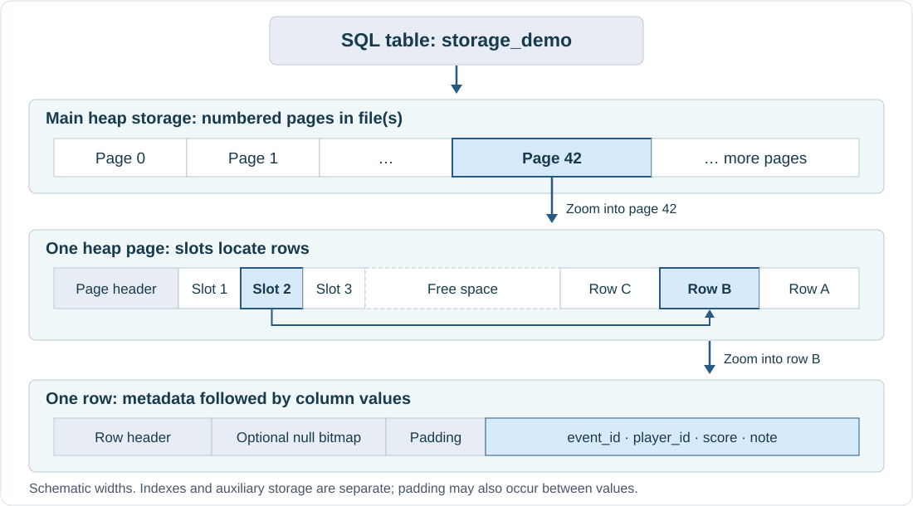
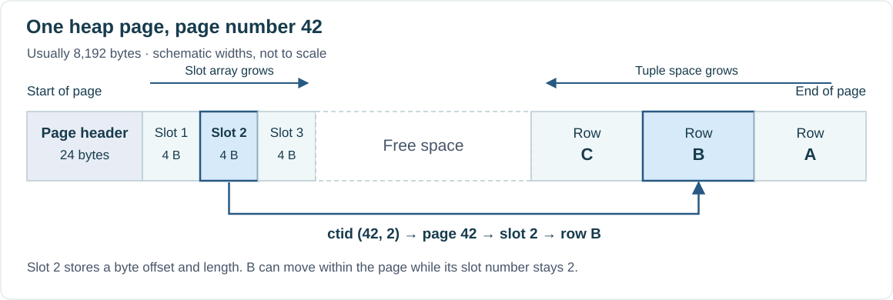
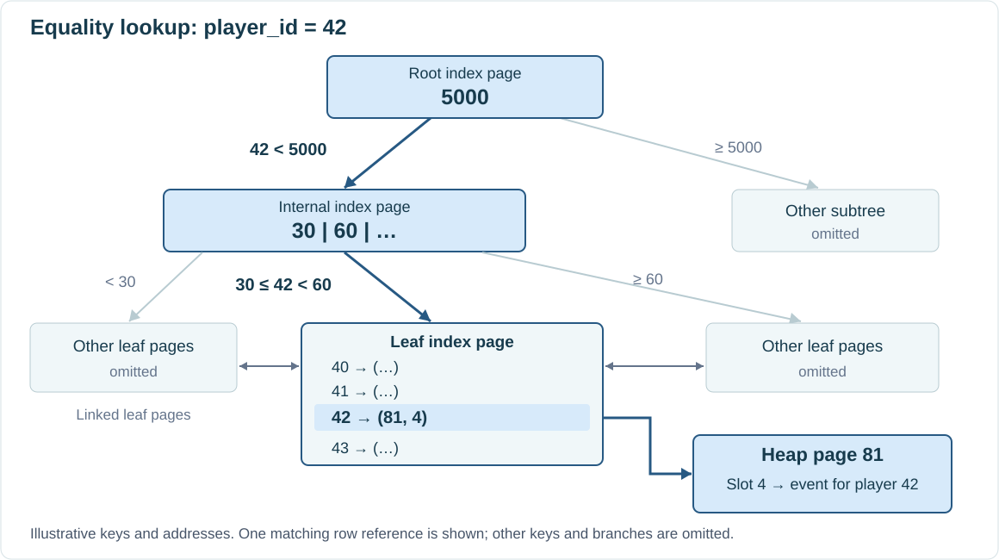

::: {.lesson-hero}
::: {.lesson-kicker}
WEEK 13 · PHYSICAL STORAGE
:::

# Where does a PostgreSQL row live?

A SQL table looks like a grid. PostgreSQL stores it as **pages of bytes**, with data structures that locate each record and describe its values. We will follow that representation from the table down to one stored row, then use it to explain scans and indexes.
:::

**Previous:** [Putting each fact in the right table](week-12-normalization.qmd). Normalization organizes facts logically; today we examine their physical representation. The examples use PostgreSQL's standard **heap** tables.

::: {.callout-important appearance="simple"}
### Two goals for today

1. **Explain how a row is stored:** table files → heap pages → slots → row metadata and values.
2. **Recognize when an index can help:** connect a query's filters, joins, or ordering to a suitable index and the work it can avoid.
:::

## 1. Start with the unit of storage: a page

::: {.callout-tip appearance="simple" icon="false"}
### Definition: Page or block

A **page** is a fixed-size unit PostgreSQL reads into memory and writes back to storage. Its usual size is **8 KiB: 8,192 bytes**. A page normally holds many records.
:::

### Why pack records into pages?

- **Transfer data in chunks:** PostgreSQL manages reads and writes at page granularity, rather than issuing a separate tiny operation for each field.
- **Reuse a read:** once a page is in memory, PostgreSQL can examine several records without fetching that page again.
- **Track space:** fixed-size pages give PostgreSQL a consistent unit for locating records, caching data, and reusing free space.

**Each row must fit on one heap page.** PostgreSQL does not continue a heap record onto the next page. Large eligible values can be compressed or stored separately through **TOAST**, which we will see below.

A page is a database storage unit, not an individual SSD cell or disk sector. We can now trace what PostgreSQL puts inside it.

## 2. A table is stored as a heap of pages

Our running example is `storage_demo`, a table of game events. Each event has an ID, a player ID, a score, and an optional note.

{fig-alt="Top to bottom: the SQL table storage_demo; its main heap files containing numbered pages, with page 42 selected; slots and rows within page 42, with slot 2 pointing to row B; and the contents of row B, including metadata and column values. Indexes and auxiliary storage are separate and omitted."}

::: {.callout-tip appearance="simple" icon="false"}
### Definition: Heap storage

PostgreSQL's standard **heap** stores rows in numbered pages, without maintaining a sorted order by a particular key. This is a file organization, not the heap data structure used for a priority queue.
:::

- **Files:** the table's main data is a sequence of pages stored in one or more file segments.
- **Insert:** PostgreSQL can consult a **free-space map** to find a page with room, or extend the table.
- **Placement:** rows for the same player need not be neighbors. SQL needs `ORDER BY` when output order matters.
- **Other storage:** indexes, auxiliary maps, and out-of-line values have separate storage; they are omitted from the overview.

See PostgreSQL's [file layout](https://www.postgresql.org/docs/current/storage-file-layout.html) and [free-space map](https://www.postgresql.org/docs/current/storage-fsm.html).

### Our running example: game events

[Download the storage demo setup SQL](storage-demo-setup.sql){download="storage-demo-setup.sql" .btn .btn-primary}

Run the file once in the schema you use for coursework. It creates a regular table with 100,000 events that remains available after you disconnect. In an interactive `psql` session, use `\i storage-demo-setup.sql`; in a graphical editor, open and execute the file.

- **100,000 events**, with ten events per player; player 42 has ten matches.
- The primary key creates an index on `event_id`; `player_id` starts **unindexed**.
- The script runs `ANALYZE` to gather query-planning statistics.

## 3. A page uses slots to locate its records

Zoom into page 42. PostgreSQL uses a **slotted page**: a small array of entries locates the rows elsewhere in that same page. These records can have different lengths.

1. A page header describes the page and its free space.
2. A **slot**, called a line pointer or item identifier in PostgreSQL, records a tuple's location and length.
3. The slot array grows from the front; rows are allocated from the back. Free space lies between them.

{fig-alt="Schematic PostgreSQL heap page 42. A 24-byte page header precedes three 4-byte line pointers. Free space separates the pointers from rows C, B, and A at the other end. Slot 2 points to row B. Moving B within this page changes its slot's byte offset, not the slot number."}

For PostgreSQL's usual heap-page format:

- **Page header:** 24 bytes.
- **Line pointer:** four bytes per slot.
- **Tuple space:** includes each record's header, padding, and values.

If tuple bytes move during page compaction, PostgreSQL can update the line pointer while retaining the slot number. The record's **byte offset** and its **slot number** are different things.

### A physical address is not a primary key

PostgreSQL exposes **`ctid`** as `(block_number, offset_number)`: the row's **page (block) number** and **slot number** within that page.

`(42, 2)` means **page 42, slot 2**, not event 42 or byte offset 2. Page numbers start at zero; slot numbers start at one.

<details class="practice-example">
<summary>Practice 1: how many records fit?</summary>

Assume an 8,192-byte page, a 24-byte page header, and a four-byte slot per record. Each stored record occupies **100 bytes including its own header and padding**. Ignore other overhead and unused space policies.

How many records fit? If the average record becomes larger, what happens to the number of pages needed for the same row count?

<details class="practice-solution">
<summary>Possible answer</summary>

`floor((8192 - 24) / (100 + 4)) = 78` records.

Larger records generally mean fewer records per page and more pages to store or scan. This is a simplified capacity calculation, not an exact PostgreSQL table-size prediction.

</details>
</details>

## 4. Inside one row: metadata and values

Following a slot brings us to a stored row, also called a **heap tuple**. Its bytes have this general shape:

```text
[ row header | optional null bitmap | alignment padding | column values ]
```

- **Header:** transaction information, flags, and the start of the column data. The fixed portion is usually 23 bytes, before padding and optional information.
- **Null bitmap:** present when the row contains null values; indicates which columns have no stored value.
- **Alignment:** padding lets certain types begin at suitable byte boundaries.
- **Values:** PostgreSQL interprets the bytes using the column types in the schema; column names and types are not repeated in every record. Padding may also occur between values.

### How are the column values represented?

| Attribute in our example | Stored representation |
|---|---|
| `event_id`, `player_id`, `score` | Four bytes each: `integer` uses a fixed-width binary representation |
| A short `note`, such as `event 1` | Length information followed by text bytes |
| A null `note` | A flag in the null bitmap; no bytes for the value itself |

Records in the same table can therefore have **different lengths**. PostgreSQL uses the schema, null information, and type-specific lengths and alignment to find the values within each record.

::: {.callout-note appearance="simple"}
**A row is not a line of CSV.** Its size includes metadata and padding as well as data values. Also, `varchar(100)` limits the number of characters; it does not reserve 100 characters of storage for every value.
:::

See PostgreSQL's [row layout](https://www.postgresql.org/docs/current/storage-page-layout.html#STORAGE-TUPLE-LAYOUT) and [character-type storage](https://www.postgresql.org/docs/current/datatype-character.html).

<details class="practice-example">
<summary>What if a text value is larger than a page?</summary>

PostgreSQL does not split one heap tuple across pages. **TOAST**, its oversized-attribute mechanism, can compress eligible values and/or store them in a separate TOAST table, leaving a small reference in the main record.

- A large `text` value can therefore fit logically in a row whose main record fits on one page.
- Reading other columns need not retrieve the full out-of-line value.
- A long string is not necessarily stored out of line: its type, size, compression, and storage settings matter.

See [PostgreSQL TOAST](https://www.postgresql.org/docs/current/storage-toast.html).

</details>

### Inspect a stored event

```sql
SELECT event_id, player_id, ctid,
       pg_column_size(d.*) AS row_value_bytes
FROM storage_demo AS d
ORDER BY event_id
LIMIT 5;
```

- `event_id` identifies the **logical event**.
- `ctid` locates its **current physical row** in this table.
- `d` names the table in `FROM`; **`d.*` inside this function passes all columns of the current row as one value**. `d.note` would pass just its note.
- `pg_column_size(d.*)` returns a size in **bytes for each row**, including its record metadata and padding. Page headers, line pointers, and free space are additional overhead.

::: {.callout-important appearance="simple"}
**Use primary keys for identity.** `ctid` can change after an update or a table rewrite. It is useful for inspecting storage, but should not be stored as a foreign key. See [PostgreSQL system columns](https://www.postgresql.org/docs/current/ddl-system-columns.html).
:::

## 5. A scan works through pages in memory

The **buffer manager** keeps copies of database pages in RAM:

1. If a needed page is cached, use that copy.
2. Otherwise, obtain a buffer and read the page, possibly replacing another cached page.
3. Access the records in the page. Modified pages eventually need to be written back.

Our table uses PostgreSQL's **shared buffer pool**, alongside operating-system caching.

::: {.callout-note appearance="simple"}
**Returning few rows does not mean reading few pages.** Without a suitable access path, a **sequential scan** examines the table's pages and tests records against the filter. A query returning ten events might inspect all 100,000 events.
:::

Caching can make a repeated scan faster. It does not mean the second query found a new way to locate the matching records. See PostgreSQL's [shared buffer documentation](https://www.postgresql.org/docs/current/runtime-config-resource.html#GUC-SHARED-BUFFERS).

## 6. An index supplies another way to find records

::: {.callout-tip appearance="simple" icon="false"}
### Definition: Index and search key

An **index** is an additional access structure for locating records. Its **search key** is the column or combination of columns used for lookup. A search key need not be unique or be the table's primary key.
:::

PostgreSQL calls its default index **B-tree**; it uses a **B+ tree organization**: internal pages guide searches, linked leaf pages hold row references. The table rows remain in the heap. See [PostgreSQL's index structure](https://www.postgresql.org/docs/current/btree.html#BTREE-STRUCTURE).

<details class="practice-example">
<summary>Why a B-tree instead of a binary search tree?</summary>

- **More choices per node:** a binary search tree node typically holds one key and has at most two children. A B-tree page holds many keys and child pointers; this branching factor is called **fan-out**.
- **Fewer levels:** high fan-out keeps a B-tree shallow, even compared with a balanced binary search tree. B-trees also maintain balance as entries change.
- **Fewer page accesses:** after loading a page, PostgreSQL can compare its keys in memory and choose the next child page. A shorter path means fewer pages to access; cached pages may require no storage read.

**Make each page access useful:** compare many keys in memory before fetching another page. See the textbook's [indexing slides](https://www.db-book.com/slides-dir/PDF-dir/ch14.pdf).

</details>

### Follow an equality lookup through a B-tree

Suppose we have a B-tree index on `player_id` and run:

```sql
SELECT event_id, note
FROM storage_demo
WHERE player_id = 42;
```

**Follow sorted keys down the tree, then a row reference into the heap.**

{fig-alt="Simplified B-tree lookup for player_id 42. At the root, 42 is less than 5000, so follow the left child. At the next internal page, 30 is less than or equal to 42 and 42 is less than 60, so follow the middle child. In that leaf, an entry for 42 references heap page 81, slot 4, where the event row is stored. Other keys, branches, and matching references are omitted."}

1. **Root:** `42 < 5000`, so follow the left child pointer.
2. **Internal page:** `30 ≤ 42 < 60`, so follow that child pointer to a leaf.
3. **Leaf:** find `42` and read a matching row reference, such as `(81, 4)`.
4. **Heap:** load page 81 and use slot 4 to locate the event row and read its `note`.

This diagram uses **illustrative keys and addresses**, not the actual demo index. Player 42 has ten events: PostgreSQL follows all matching references to retrieve them. Each tree node is a page containing many entries; most branches are omitted here.

::: {.callout-note appearance="simple"}
**The index key is not the heap address.** `42` is the player we searched for; `(81, 4)` tells PostgreSQL where a matching row is stored.
:::

::: {.callout-important appearance="simple"}
**Heap rows + ordered indexes:** the heap stores rows where space is available; separate B-tree indexes supply ordered keys and row references. Multiple indexes can point to the same rows. Creating an index does not reorder the heap.
:::

### Which queries can benefit from a B-tree index?

For an index on **`player_id`**, look for these patterns:

| Query pattern | Example SQL fragment | Work the index can avoid |
|---|---|---|
| **Equality lookup** | `WHERE player_id = 42` | Scanning every event to find one player's ten events |
| **Narrow range** | `WHERE player_id BETWEEN 40 AND 45` | Locate the first match, then follow linked leaf pages until the range ends |
| **Ordered results with a limit** | `ORDER BY player_id LIMIT 10` | Reading and sorting the entire table to find the first ten rows in that order |
| **Join lookups** | `ON e.player_id = p.player_id` | Repeatedly scanning all events when finding matches for a small set of players |

The join example uses `storage_demo AS e` and a separate `players AS p` table. The useful index locates each player's matching events.

::: {.callout-note appearance="simple"}
**Match the index to the query.** An index on `player_id` provides no direct lookup by `score`. Even a matching index may be skipped if most rows qualify: a heap scan can be cheaper than many scattered fetches. Indexes also take space and add work when data changes.
:::

See PostgreSQL's [index introduction](https://www.postgresql.org/docs/current/indexes-intro.html), [B-tree capabilities](https://www.postgresql.org/docs/current/indexes-types.html#INDEXES-TYPES-BTREE), and [indexes with ORDER BY](https://www.postgresql.org/docs/current/indexes-ordering.html).

## 7. Compare the access paths with EXPLAIN

First inspect the player lookup **before** adding its index:

```sql
EXPLAIN (ANALYZE, BUFFERS)
SELECT event_id, note
FROM storage_demo
WHERE player_id = 42;
```

Now create the index and repeat the same query:

```sql
CREATE INDEX storage_demo_player_idx ON storage_demo (player_id);
ANALYZE storage_demo;

EXPLAIN (ANALYZE, BUFFERS)
SELECT event_id, note
FROM storage_demo
WHERE player_id = 42;
```

| Plan information | What to look for |
|---|---|
| `Seq Scan` | Scan heap pages and apply the filter |
| `Index Scan` | Find entries through the index, then fetch heap tuples |
| `Bitmap Index Scan` + `Bitmap Heap Scan` | Collect matching tuple locations, then visit the relevant heap pages |
| `actual ... rows` | Rows produced by a node; these need not equal rows examined |
| `Buffers` | Page accesses, including cache hits and reads |

- **`EXPLAIN`** shows the chosen plan; **`ANALYZE` inside `EXPLAIN` executes the query** and adds measurements.
- Before the new index, expect a sequential scan. Afterwards, expect an index-based path for these ten matches; exact choices and timings vary.
- Accesses to this regular table and its indexes report **`shared`** buffers.
- A buffer **hit** uses a page already cached by PostgreSQL. A **read** brings it into that cache, potentially from the operating-system cache rather than the physical device. Counts are accesses, not necessarily distinct pages.

<details class="practice-example">
<summary>Practice 2: where would the player index help?</summary>

For each fragment, explain what an index on `player_id` could help PostgreSQL do, or why it might not help.

1. `WHERE player_id = 42`
2. `WHERE player_id BETWEEN 1 AND 9000`
3. `ORDER BY player_id LIMIT 10`
4. `WHERE score = 90`

<details class="practice-solution">
<summary>Possible answer</summary>

1. **Promising:** selects ten of 100,000 events; the index locates their row references directly.
2. **Less promising:** selects 90,000 events; PostgreSQL may prefer a sequential scan.
3. **Promising:** the index supplies the requested order and lets PostgreSQL stop after ten rows.
4. **Wrong search key:** the player index does not locate rows by score. An index on `score` would match this filter, though its benefit still depends on how many rows qualify.

The query planner chooses an access path; creating an index does not require every query to use it.

</details>
</details>

::: {.takeaway-panel}
## Two things to take away

1. **How rows are stored:** a table's heap files contain pages; slots locate rows within each page. Each row contains metadata and column values. The heap maintains no key order.
2. **When an index helps:** a suitable B-tree can support equality lookups, narrow ranges, join lookups, and ordered results with a limit. Ask **which column is indexed and what work the query can avoid**; retrieving most rows may favor a scan.
:::

**Reading:**

- *Database System Concepts*, 7th ed., **Data Storage Structures** and the opening material in **Indexing**. [Storage slides](https://www.db-book.com/slides-dir/PDF-dir/ch13.pdf); [indexing slides](https://www.db-book.com/slides-dir/PDF-dir/ch14.pdf).
- PostgreSQL: [database file layout](https://www.postgresql.org/docs/current/storage-file-layout.html), [page and tuple layout](https://www.postgresql.org/docs/current/storage-page-layout.html), and [free-space maps](https://www.postgresql.org/docs/current/storage-fsm.html).
- For the demonstration: [Using EXPLAIN](https://www.postgresql.org/docs/current/using-explain.html).
